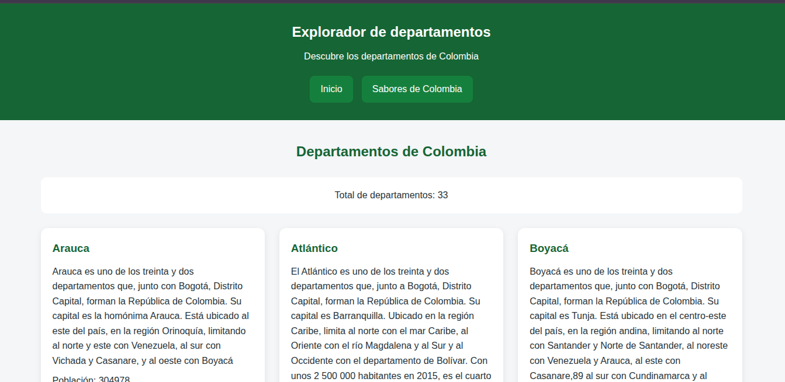
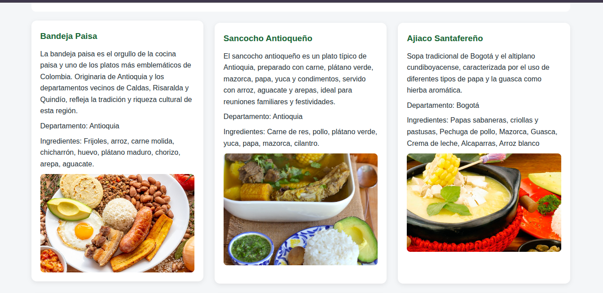
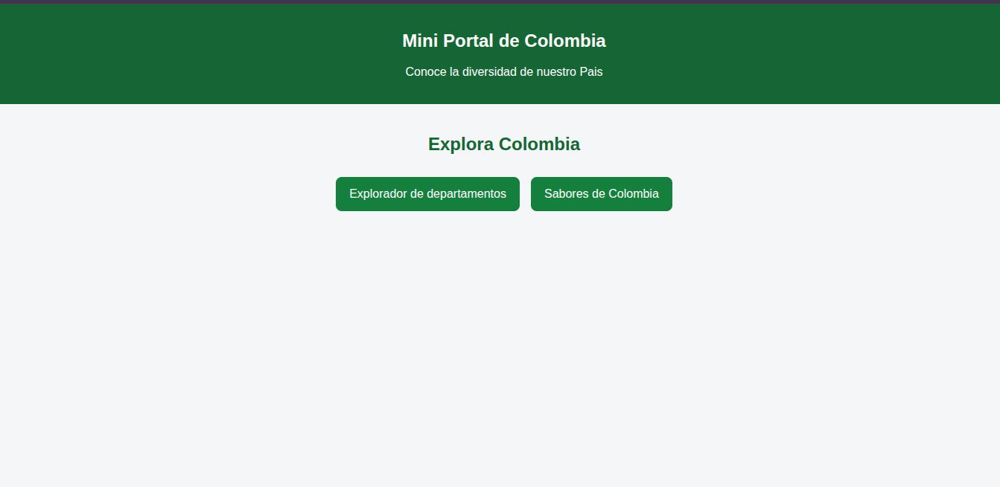

# Mini Portal de Colombia 🇨🇴

## 1. Descripción del proyecto

Mini Portal de Colombia es una página web que permite explorar información sobre los departamentos de Colombia y conocer algunos de sus platos típicos. La información se obtiene mediante una API y se muestra dinámicamente en la página.

## 2. Tecnologías utilizadas

- HTML5: estructura de las páginas.
- CSS3: diseño y estilos.
- JavaScript: consumo de la API y creación dinámica de elementos.
- Fetch API: conexión y obtención de datos.

## 3. Instrucciones de uso

1. Descargar o clonar el repositorio.
2. Abrir la carpeta del proyecto en Visual Studio Code.
3. Ejecutar el archivo `index.html` utilizando Live Server.
4. Seleccionar la sección que se desea explorar:
   - Departamentos de Colombia.
   - Sabores de Colombia.
5. Navegar por la información y las tarjetas disponibles.

## 4. Capturas de pantalla

### Captura 1

### Captura 2

### Captura 3

## 5. Nombre del estudiante

**Valentina Rojas Moratto**